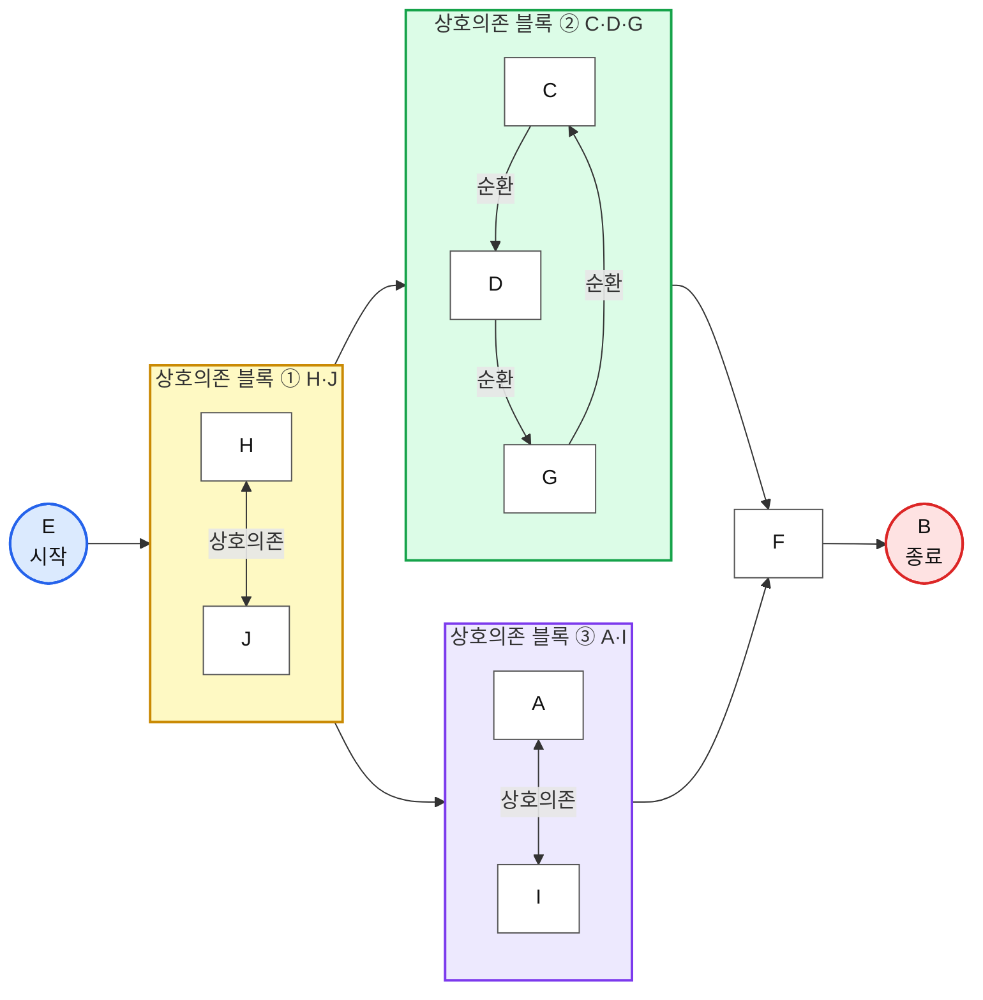
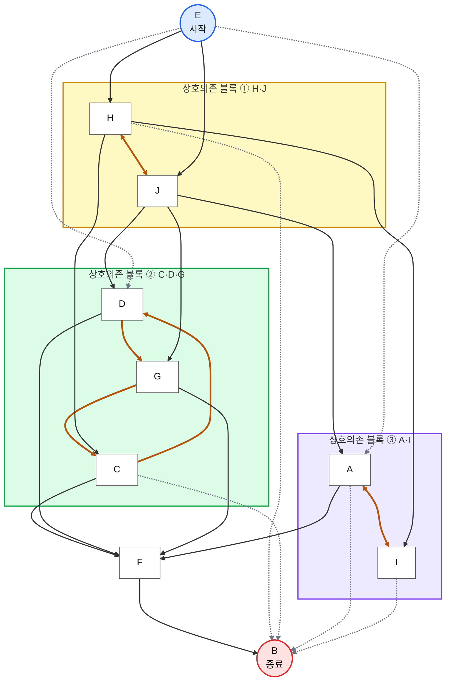

# PRD — Mermaid DSM 스크롤형 웹 발표

> 버전 2.0 · 2026-10-22 · 사용자 피드백 반영  
> 콘텐츠 정본: [PRESENTATION_PLAN.md](PRESENTATION_PLAN.md)

> 상단 공통 헤더 갱신(2026-10-23): Atlas와 동일한 KAIST 브랜드·프로젝트 복귀 링크·좌측 정렬 섹션 탭을 사용한다. 헤더에만 파랑 `#3355d1` / 연한 파랑 `#e9edfc`를 적용하며 본문 Mermaid 핑크는 유지한다. 모바일은 한 줄 헤더와 가로 스크롤 탭, 우측은 전체 화면 아이콘을 제공한다.

## 1. 목표와 변경 방향

7분 수업 발표를 한 웹페이지에서 자연스럽게 스크롤하며 진행한다. 제목 → 결과 → 개념 → 데모 → 실제 과제 → 마무리 순서다. 이전 4슬라이드 전환 방식은 폐기하며, 화면 숨김·이전/다음 페이지 버튼·방향키 강제 전환은 제거한다.

참고 디자인은 기존 `korea-genai-research-atlas`다. 스크롤 구성, 헤더, 제목과 우측 메타 정보, 카드 언어를 계승한다. Mermaid 공식 핑크를 브랜드색으로 유지한다.

## 2. 경로·빌드

```text
mini-projects/
├── study/kaist_itm/projects/mermaid-dsm-presentation/
│   ├── index.html
│   ├── assets/                 # 로컬 Mermaid, 원본 캡처, MD, 라이선스
│   ├── mermaid-assets/         # 앱 JS/CSS
│   └── README.md
└── _tools/mermaid-presentation/
    ├── index.html
    ├── src/
    ├── public/assets/
    ├── scripts/vendor.mjs
    ├── scripts/sync-site.mjs
    ├── package.json / package-lock.json
    ├── vite.config.js
    ├── PRESENTATION_PLAN.md / WEB_PRESENTATION_PRD.md
    ├── README.md
    └── dist/
```

- 기존 `seminar/mermaid.html` 대신 새 경로의 `index.html`을 진입점으로 사용한다.
- Vite + 바닐라 JavaScript, Mermaid 11.12.0, QRCode 1.5.4. 의존성은 lockfile로 고정.
- `npm run build`는 dist, `npm run build:site`는 빌드 후 새 프로젝트 경로로 복사한다.
- 상대 자산 경로를 사용해 GitHub Pages의 중첩 경로와 오프라인 로컬 서버를 지원한다.
- 서버/API/계정/AI API 호출은 없다. 외부 폰트 요청 없이 시스템 폴백을 사용한다.
- `file://` 더블클릭 대신 `python3 -m http.server`로 실행한다.

## 3. 정보 구조

| 앵커 | 구성 | 수락 조건 |
|---|---|---|
| `#intro` | 제목·소제목 + 우측 메타 | 첫 화면에서 과제보다 발표의 제목이 먼저 보임 |
| `#results` | 정렬 DSM과 결과 그림 | v3 p.4/p.6 실제 캡처, 출처 표시 |
| `#concept` | 3줄 코드와 그림 | 아이디어 → 검토 → 실행, `A --> B` 설명 |
| `#demo` | 라이브 코드와 SVG | 프리셋 3개, 직접 편집, 오류·리셋 |
| `#case` | 심플/상세 + AI 활용 과정 | 원본 소스, 세 블록, 확대 보기, 분석·검증 구분 |
| `#takeaways` | 오늘 기억했으면 하는 세 가지 | 사용자 지정 세 문장, Live Editor 링크·QR 상시 노출 |

상단 고정 목차는 결과/개념/라이브 데모/실제 과제/정리로 이동한다. 스크롤을 강제 고정하거나 스냅하지 않는다. 브라우저의 기본 PageUp/Down과 편집기 키 조작을 가로채지 않는다.

### 도입 카피

- 제목: **그림을 그리지 않고, 그림을 만드는 방법**
- 소제목: **Mermaid와 생성형 AI를 활용한 다이어그램 시각화**
- 우측: **작성일: 2026-10-22 · 형식: 수업 시작 7분 미니 공유**
- 우측: **KAIST ITM60062 아키텍처 혁신과 모노즈쿠리**, 김예나
- 모바일에서는 메타 정보를 제목 아래에 배치한다.

### 마무리 카피 (사용자 지정)

**오늘 기억했으면 하는 세 가지**

1. Mermaid는 텍스트로 다이어그램을 만드는 도구다.
2. 생성형 AI와 함께 사용하면 문법을 몰라도 쉽게 시작할 수 있다.
3. 중요한 것은 그림을 예쁘게 그리는 것이 아니라, 표현하려는 관계를 정확히 정의하는 것이다.

## 4. 기능 요구

- 모든 구간은 같은 문서에서 동시에 존재하며 기본적으로 표시한다. 심플/상세만 구간 내부 버튼으로 전환한다.
- 300ms debounce 후 Mermaid SVG 렌더. 직렬 렌더 큐와 세대 ID로 오래된 결과 덮어쓰기를 방지.
- 오류는 읽기 쉬운 텍스트로 표시하고 마지막 정상 SVG를 유지. 초기화는 시연 1단계로 복구.
- `securityLevel: strict`; 사용자 코드를 임의 HTML로 삽입하지 않음.
- 프리셋 1: E → H·J → C·D·G → F → B.
- 프리셋 2: H·J → A·I → F 병렬 경로 추가.
- 프리셋 3: 2와 동일한 관계, LR에서 TB로 변경.
- 초기화·코드 복사·전체 화면·원본 그래프 확대/축소·닫기·QR을 유지한다.
- 새로고침하면 데모 1단계, 심플 원본을 표시한다. 입력 내용은 저장하지 않는다.
- 네트워크 차단 상태에서도 제목·모든 구간·이미지·편집·QR 생성이 동작해야 한다. 외부 링크 방문만 인터넷을 사용한다.

## 5. 디자인·접근성

- 배경 `#f6f7f9`, 카드 `#ffffff`, 본문 `#16181d`, 테두리 `#e3e6eb`.
- Mermaid 공식 사이트의 브랜드색 `#e0095f`, 짙은 보조색 `#b0134a`. 연한 강조면 `#fdebf2`는 파생색.
- 밝은 테마, 14px 카드 모서리, 얇은 테두리, 절제된 그림자. 다크 모드는 범위 밖.
- 제목 38–64px, 구간 제목 30–46px, 본문 20–27px, 코드 데스크톱 20–24px. 좁은 화면은 코드 16px까지 허용.
- 1366×768, 1920×1080에서 프로젝터 가독성 확인. 페이지 자체 세로 스크롤은 의도한 동작이다.
- 390px에서 제목·메타·패널을 세로로 재배치하고 페이지 가로 넘침을 방지.
- 앵커 이동 시 고정 헤더에 제목이 가리지 않게 함. 포커스 표시, 버튼 라벨, 그래프 설명, 오류 live region 유지.
- `prefers-reduced-motion`에서는 부드러운 스크롤을 제거한다.

## 6. 실제 과제 정본

사용자 지정: `../../과제/W05_Process_DSM_HW/W05_Process_DSM_HW_플로우차트_20263864_김예나_v3.pdf`.

- p.4 정렬 DSM, p.5 직접 입력 관계, p.6 심플, p.7 상세.
- 원본 코드: 같은 과제 폴더 `W05_Process_DSM_HW_플로우차트_mermaid.md`.
- `{H,J}`, `{C,D,G}`, `{A,I}` 세 상호의존 블록. `{C,D,G}`와 `{A,I}` 병렬 가능.
- 직접 관계 25개 = 블록 내부 7 + 실선 12 + 점선 6. SVG 간선은 양방향 2개를 포함해 23개.
- 축약 시연 그래프와 원본을 명시적으로 구분. 원본 블록 색상과 관계는 유지.
- “Claude + Mermaid 이용”은 제출물에 근거. 확인되지 않은 프롬프트·과정은 지어내지 않음.

### 원본 심플 버전 (링크된 원본 MD를 기반으로 반영)



### 원본 상세 버전 (링크된 원본 MD를 기반으로 반영)



> 원본 MD의 상세버전 범례는 렌더링 이후 추가했다고 명시되어 있다. `classDef`/`linkStyle`/init 설정은 렌더러 버전에 따라 약간 다르게 표시될 수 있으므로, **시각적 스타일보다 의존관계·방향·노드 정확성**을 우선 검증한다.


## 7. 수락 검증

1. 빌드 성공 및 새 프로젝트 경로에 index.html·자산 생성.
2. 제목·소제목·우측 발표 정보가 첫 화면에 표시.
3. 5개 본문 구간이 숨김 없이 스크롤로 연결되고 상단 앵커·뒤로가기 동작.
4. 데모 1/2/3의 노드·간선·방향, 직접 입력, 빠른 프리셋 전환 검증.
5. 오류 유지·초기화, 편집기 키 입력, 원본 심플/상세와 확대 검증.
6. 마지막에 사용자 지정 세 문장과 QR이 별도 조작 없이 표시.
7. 3개 해상도에서 가로 넘침과 잘림 확인. 세로 스크롤은 허용.
8. 캐시 삭제·외부 요청 차단 후 로컬 서버에서 재로딩 및 데모 검증.
9. 실제 중첩 경로에서 모든 자산 정상 로딩.
10. README와 기획서의 경로·실행 방법·스크롤형 진행 설명 갱신.

검증 환경과 제약은 README에 기록한다. 실제 교실 프로젝터 리허설은 별도다.
