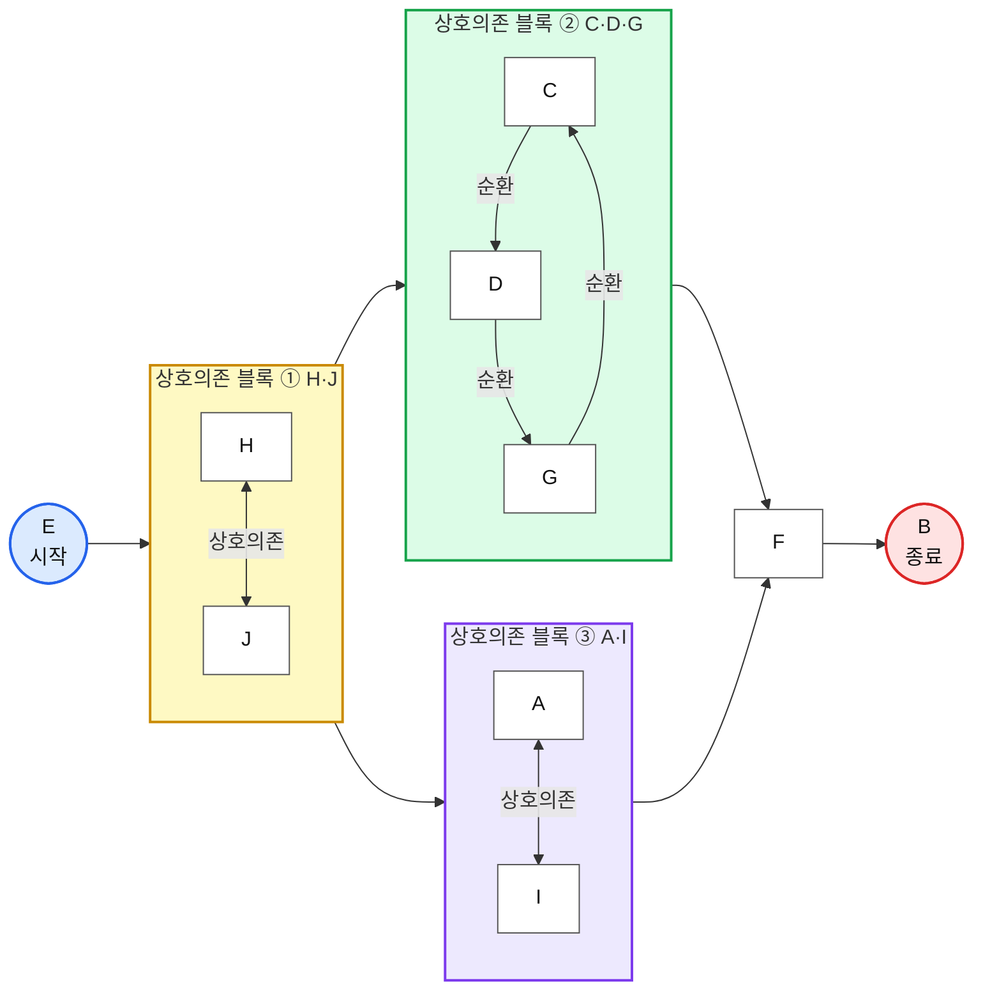
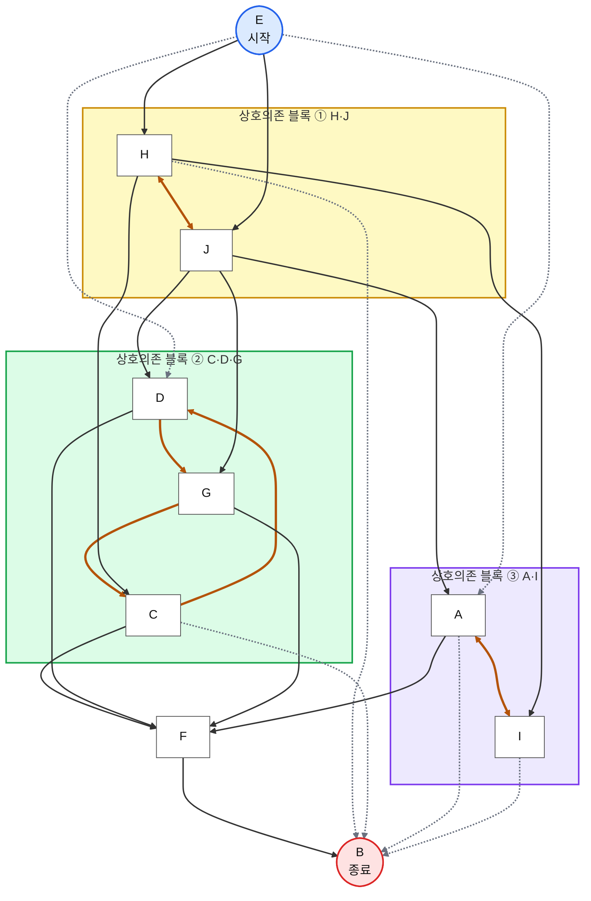

# Process DSM HW — 플로우차트 Mermaid 소스

- 정렬 순서: E → H, J → C, D, G → A, I → F → B (X 25개 = 블록 내부 7 + 실선 12 + 점선 6)
- 렌더링: `npx -y @mermaid-js/mermaid-cli -i flow.mmd -o out.png -b white -s 3` (상세버전 하단 범례는 렌더링 후 덧붙임)

## 심플버전

## 상세버전

